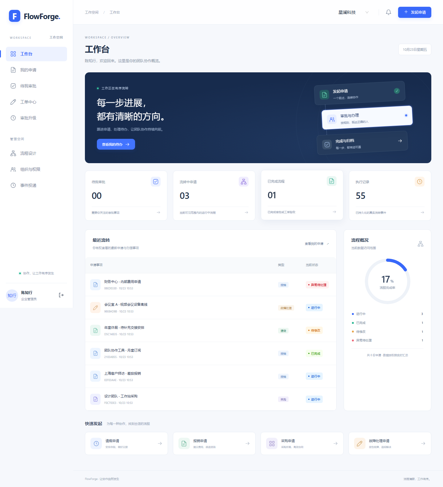
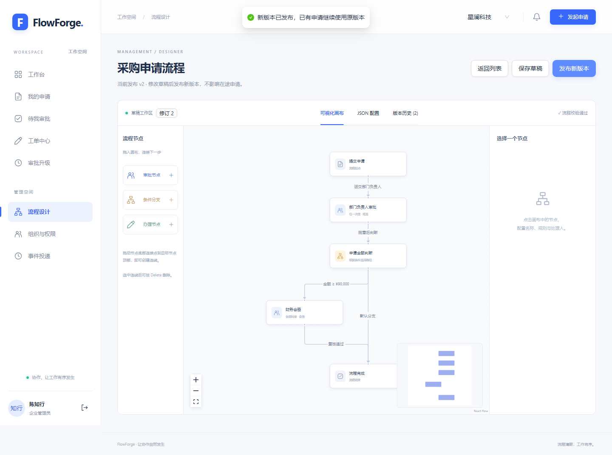
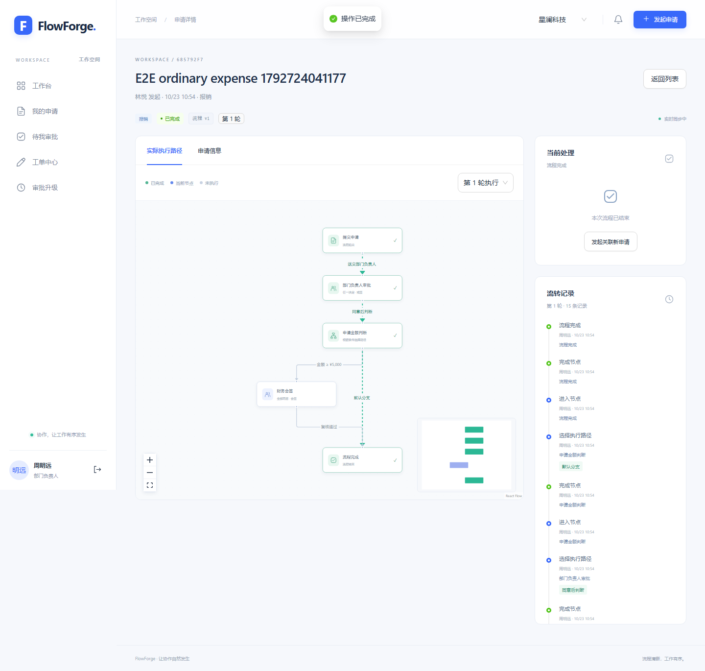

# FlowForge

[](https://github.com/davidZhang666-bin/FlowForge/actions/workflows/quality.yml)

**拖拽配置审批规则，用真实执行事件看见每一次流转。**

一个可运行的多企业审批与工单系统：React 可视化设计器、NestJS API、独立 TypeScript 流程引擎、PostgreSQL 事务与后台事件投递。包含请假、报销、采购、故障四种模板、双企业演示数据，以及真实数据库并发测试。



## 本地启动

需要 **Node.js 24 LTS（24.11+）和 pnpm 11.5.0**。本地开发不需要 Docker，首次安装会下载可移植 PostgreSQL 18 二进制。Windows x64、Linux 全套 CI 和 Docker Compose 启动均已验证，详见 [验证记录](docs/validation.md)。

```sh
git clone https://github.com/davidZhang666-bin/FlowForge.git
cd FlowForge
npm install --global pnpm@11.5.0
pnpm install --frozen-lockfile
pnpm setup
pnpm db:seed
pnpm dev
```

访问 **http://localhost:5173**。API 在 `127.0.0.1:3100`，Worker 健康端点在 `127.0.0.1:3102/health`。`setup` 创建随机数据库凭据，写入被 Git 忽略的 `.env`，初始化数据库、迁移并授权给非所有者账号。

`setup` 会尝试后台启动数据库。如果终端环境不保留后台进程，或电脑重启后，在另一个终端运行 `pnpm db:start`，保持该终端打开，再运行 `pnpm dev`。结束开发时先停止应用，再运行 `pnpm db:stop`；数据保存在 `.local/postgres`。

演示密码为 `.env` 中的 `DEMO_PASSWORD`，默认 `FlowForge2026!`。账号仅用于本地演示：

| 工作邮箱                 | 身份                  | 可以演示                             |
| ------------------------ | --------------------- | ------------------------------------ |
| admin@flowforge.demo     | 陈知行 · 企业管理员   | 设计、发布、权限、异常恢复、管理审计 |
| employee@flowforge.demo  | 林悦 · 产品研发部成员 | 提交、撤回、退回重提、故障验收       |
| manager@flowforge.demo   | 周明远 · 部门负责人   | 部门审批、转交、超时接管             |
| finance1@flowforge.demo  | 许清禾 · 财务审批专员 | 会签第一席位                         |
| finance2@flowforge.demo  | 陆予安 · 财务审批专员 | 会签第二席位                         |
| agent@flowforge.demo     | 程野 · 服务工程师     | 认领、处理、解决工单                 |
| colleague@flowforge.demo | 沈星 · 财务中心成员   | 不同部门的数据范围                   |

第二家企业使用相同账号前缀和 `@northstar.demo` 域名，业务数据独立。种子脚本可重复执行，不重置已有业务和密码；生产环境禁止运行演示种子。

## 业务能力

| 模块     | 行为                                                                                          |
| -------- | --------------------------------------------------------------------------------------------- |
| 流程设计 | 拖入节点、移动节点、连线、配置处理人和 SLA；JSON 编辑；发布前校验可达性、环路、规则和默认分支 |
| 条件分支 | 金额、部门、申请类型、请假时长和优先级；组合 all / any / not；按分支顺序匹配                  |
| 审批     | 会签全部通过、或签首个有效决定；转交、拒绝、退回、撤回；禁止自审                              |
| 版本     | 发布版本不可修改；新申请绑定最新版本，旧申请及退回重提保持原版本                              |
| 工单     | 认领 → 开始处理 → 解决 → 申请人验收；验收前可重开，支持转交；验收后再发生可关联新单           |
| 超时     | 自动升级提醒与审计；保留原审批席位，由有权限的负责人显式转交接管                              |
| 数据权限 | 企业 RLS 隔离；本人及参与事项、本部门、部门树、全企业四类范围；实时复核有效成员身份           |
| 实时轨迹 | SSE 增量通知驱动刷新；按审批轮次显示走过的分支、当前节点和真实操作事件                        |
| 事件运营 | 事务 Outbox、去重投递、指数退避、死信重投、不可变业务与管理审计                               |

默认报销金额 **≥ ¥5,000**、采购金额 **≥ ¥10,000** 时增加财务会签；请假 **超过 3 个工作日** 时增加复核。金额在领域层统一使用整数分，请假时长使用整数分钟，每工作日按 8 小时计算。




## 现场演示

1. 员工提交 ¥20,000 采购申请，记住实例上的 `流程 v1`。
2. 管理员进入采购设计器，把金额分支阈值从 `1000000` 分改为 `9000000` 分，保存并发布 v2。
3. 员工再次提交 ¥20,000 采购申请，新实例显示 `流程 v2`。
4. 部门负责人分别同意两笔申请：旧单进入财务会签，新单沿默认分支直接完成；执行图实时高亮各自路径。
5. 用两名财务审批人完成旧单，验证一次会签同意不会提前结束。可继续演示退回重提、撤回竞争和工单重开。

完整操作步骤见 [演示手册](docs/demo.md)。

## 工程结构与一致性

```text
apps/web       React 19 / Ant Design / React Flow / TanStack Query
apps/api       NestJS HTTP、会话、权限与应用服务
apps/worker    Outbox 消费、超时升级、健康检查
packages/core  纯领域状态机、审批策略、规则执行与图校验
packages/contracts  Zod 输入契约、共享类型、OpenAPI
packages/data  Prisma、租户事务、聚合持久化、事件投影
prisma/        Schema 与手写约束、RLS、不可变触发器迁移
scripts/       开发数据库、隔离测试、迁移与账号初始化
```

每个实例是并发控制边界。命令先校验幂等键，再用 `expectedRevision` 条件更新；状态、任务索引、事件、Outbox 在同一 PostgreSQL 事务写入。并发冲突返回 409，前端刷新后由用户决定重试。同一幂等键和相同请求返回原结果；相同键搭配不同请求会被拒绝。

运行账号不是表所有者，没有 `SUPERUSER` / `BYPASSRLS`；租户上下文只在事务内设置。管理权限不直接赋予审批权，管理员也不能审批本人申请。

详见 [架构与状态机](docs/architecture.md)、[测试说明](docs/testing.md)、[API 契约](docs/openapi.json)。运行时接口文档：`/api/v1/openapi.json`。

## 质量验证

```sh
pnpm format:check
pnpm verify              # ESLint、双配置类型检查、单元测试、前后端构建
pnpm test:coverage       # 领域核心四项覆盖率门槛均为 90%
pnpm test:integration    # 一次性 PostgreSQL 数据库与非特权角色
pnpm test:bootstrap      # 空库迁移、权限、管理员和成员初始化
pnpm exec playwright install chromium
pnpm test:e2e            # 一次性数据库、独立端口、真实浏览器
pnpm audit
```

集成与浏览器测试需要能连接 `DATABASE_ADMIN_URL`，并拥有创建/删除测试数据库和角色的权限。脚本只清理自己生成的随机测试资源，不使用演示数据库执行测试。GitHub Actions 配置 Linux 全套检查、Windows 可移植数据库检查和 Docker Compose 启动检查，保留覆盖率、截图及失败 trace。

## 部署与边界

[部署手册](docs/deployment.md) 提供 Docker Compose、空库账号初始化、备份和故障排查。运行镜像使用非 root 用户，API 与 Worker 只接收受限数据库凭据；Web 代理关闭 SSE 缓冲。

这是完整的工程演示产品。审批图是 DAG，支持单节点会签，不包含通用 BPMN、并行网关、子流程、附件、SSO、外部邮件或人事日历。账号创建通过受控 CLI，管理界面维护现有成员权限。公开部署需要配置 HTTPS、真实组织、备份与运维策略。
