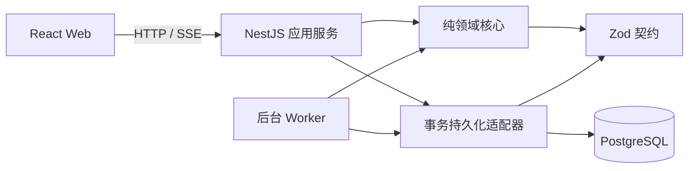
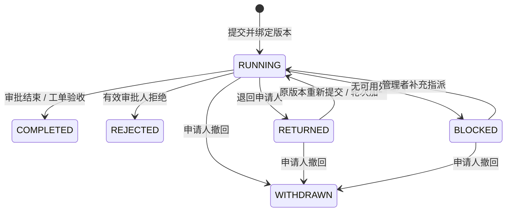
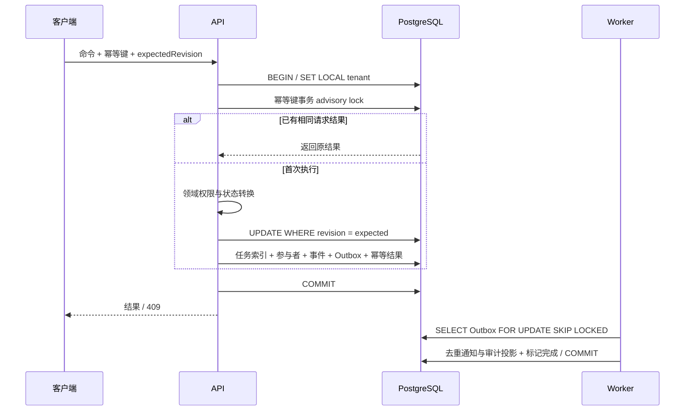

# 架构与约束

采用模块化单体：Web、API、Worker 分别运行，共享 PostgreSQL。领域核心保持纯 TypeScript，数据库与 HTTP 为适配器。

## 一致性边界

一个流程实例是并发控制边界。命令在同一事务内比较 revision、更新实例、保存事件与 Outbox。幂等键先于修订号验证，相同请求重放原结果。任何终态禁止继续审批。

发布版本不可变。第一次提交绑定最新发布版本，退回重提保持绑定。重新发起的申请选择最新发布版本。

会签全部同意才通过，或签第一个有效决定胜出。任意有效拒绝终止；退回关闭当前待办并开启新轮次。转交仅改变未完成席位的处理人。

## 权限边界

请求先验证登录和租户成员身份，再在租户事务内检查业务权限。数据库运行角色不拥有 BYPASSRLS。业务数据使用 tenant_id 和数据库行级策略隔离。

角色的数据范围分为本人、本部门、部门树、全企业；申请人和任务参与者拥有相关实例访问权。管理流程的权限不隐含替人审批的权限。禁止自审。

## 异步边界

Worker 按租户消费 Outbox，允许至少一次投递；通知和审计投影按事件去重。事件本身与业务变更原子持久化，实际轨迹读取这些事件。失败重试与死信可观察。

超时增加升级提醒，原审批规则继续有效。有权限的负责人通过显式、可审计的转交接管。

## 首版边界

审批图为有向无环图，不支持任意循环、子流程或并行网关；会签是单节点聚合策略。通知仅站内，表单提供四类模板。已验收工单再次发生时创建关联新单。

## 模块依赖



核心不依赖 HTTP、ORM、系统时钟或全局随机数。执行上下文注入时刻、ID 生成器、当前成员目录，命令返回新的聚合状态和待持久化事件，不修改调用者传入的状态。单元测试因此可以确定性验证每个转换。

`process_instances.state` 是实例的规范状态。`task_index` 和 `participants` 用于查询及授权，是与聚合同事务维护的索引；不能通过独立更新它们改变领域状态。本系统使用聚合快照与追加事件日志，不声明具备从任意历史事件完全重建状态的 Event Sourcing 能力。

## 状态机与审批策略



终态不能恢复或继续审批。退回会取消当轮未完成待办，重提重新从起点运行，旧轮次记录保留。工单在实例内部维护自己的办理状态：待认领、已指派、处理中、待验收、已关闭；重开发生在验收前，保留办理人并返回处理中。

`approvalStrategies` 为策略表：ALL 等待同一节点本轮所有有效席位同意；ANY 在第一个有效同意后取消其余待办。拒绝和退回是显式命令。多人操作时，最终结果同时受领域校验和数据库修订号保护，不能仅靠浏览器按钮禁用保障一致性。

按角色选择处理人时，部门负责人限定申请人所属部门，审批专员和服务工程师来自本企业有效成员。静态人员选择发布时校验有效企业身份；运行时再次过滤有效成员并排除申请人。没有合格处理人时进入 BLOCKED，不能默认为通过。

## 规则 DSL 与图约束

```json
{
  "op": "all",
  "rules": [
    { "op": "gte", "field": "amountCents", "value": 500000 },
    { "op": "eq", "field": "type", "value": "EXPENSE" }
  ]
}
```

只允许 `amountCents`、`leaveMinutes`、`departmentId`、`type`、`priority`。支持 eq、ne、gt、gte、lt、lte、in 和 all、any、not，不接受脚本或属性路径，不使用 eval。条件嵌套最多 8 层，大小比较只用于数字，in 只用于字符串列表。单图最多 100 节点、200 连线；HTTP JSON 最多 128 KB，结构深度超过 24 层在递归校验前拒绝。

条件节点按 JSON 中连线顺序选择第一个匹配条件；恰好一个空条件分支作为兜底。普通节点只能有一个后继。发布时检查唯一起点/终点、起终点度数、重复 ID、连线端点、可达性、全图环路、审批席位和规则类型。草稿可以保存未连接节点，发布不能绕过校验。

## 命令事务协议



幂等域为企业、操作者和键，摘要包含操作目标及规范化请求体。相同键不会跨操作者互相复用。事务 advisory lock 串行处理相同键；实例修订号处理不同键之间的竞争。审批结果重放先于修订号比较，因此成功请求即使修订号已过时仍可安全重试。幂等记录当前不自动清理，避免无意缩短重放窗口。

发布使用流程定义修订号竞争控制，新版本与定义最新版本号同事务写入。已发布 graph、领域事件、业务审计和管理审计由数据库触发器禁止修改或删除，并从运行角色撤销更新/删除权限。管理审计直接同事务写入草稿哈希、发布版本、成员权限前后值和死信重投；业务审计从 Outbox 异步投影，展示执行历史直接读领域事件。

## 租户和安全边界

租户业务表启用 FORCE ROW LEVEL SECURITY。`Database.tenant` 使用事务局部 `set_config`，连接归还池后不保留租户上下文；未设置上下文时读不到业务行。复合外键同时约束企业和关联 ID，防止跨企业挂接部门、版本、任务与成员。

用户、会话及企业目录是全局身份基础表，应用服务不会向未授权请求直接暴露完整目录。有效成员检查先于领域服务；SSE 每轮重新验证身份与可见范围，失去权限后关闭连接。通知列表也按当前实例可见范围过滤，旧通知不会保留额外数据访问权。参与过的事项保留历史可见性，停用成员可完全撤销该企业访问。

密码使用随机盐 scrypt。Cookie 会话保存随机不透明 token，数据库仅存摘要，八小时过期；Cookie 为 HttpOnly、SameSite=Lax，生产环境 Secure。CSRF token 同样只存摘要，可读 Strict Cookie 支持新标签页提交；所有受保护写请求必须同时通过会话与 CSRF。配置 Origin 校验、数据库登录限流、Helmet、输入边界和请求关联 ID。日志不记录 Cookie、密码、请求体或查询参数。

## 投递与超时

Worker 每秒执行一次扫描，每租户每轮最多消费 100 条事件；多个实例可利用 SKIP LOCKED 并行处理。事件投影事务内写通知、审计和投递完成标记，唯一键去重。失败事务回滚后递增尝试次数，按指数退避，最大间隔五分钟；五次失败进入死信，管理员显式重投并留痕。当前通知只写入本站数据库，未来接外部邮件需使用提供方幂等键，不能将数据库去重等同于外部 exactly-once。

超时扫描每轮最多检查 100 个未升级的到期任务，利用实例修订号防止重复升级。系统账号被禁止登录。升级只发一次提醒，不把会签改为或签，也不替用户审批。API `/health` 检查数据库连通性，Worker `/health` 要求最近一分钟内至少有一次成功扫描；部署监控应分别采集两者。

## 扩展方向

附件对象存储与病毒扫描、OIDC/SSO、组织同步、邮件/消息适配器和表单 Schema 可作为独立适配器扩展。任意循环、并行网关或子流程会改变令牌与聚合模型，需要单独的架构决策及兼容版本协议。当前聚合 JSON 和逐席位索引更新适合演示与中小规模业务，超大历史实例需分页、归档及性能基准后再承诺容量。
